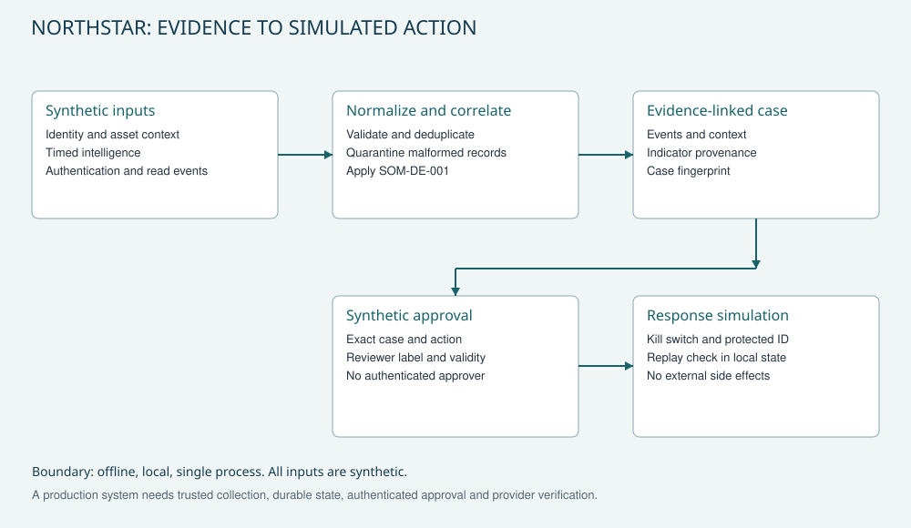

# Reference architecture

The implemented path is synthetic fixture -> normalization and correlation -> evidence-linked case -> synthetic approval -> local response simulation.

| Boundary | Contract |
|---|---|
| Input -> normalizer | Required fields, source kind, known identity/resource, timezone-aware occurrence and receipt times |
| Normalizer -> rule | Deterministic order; exact duplicates counted once; conflicting IDs quarantined |
| Intelligence -> rule | Typed IP, provenance, high confidence, TLP:CLEAR and explicit validity interval |
| Rule -> case | Same identity/session/IP, restricted successful reads, 900-second inclusive window and >=100,000,000 bytes |
| Case -> approval | Exact fingerprint and action, reviewer label, issue and expiry times |
| Approval -> simulation | Kill switch, protected-identity check and replay key in a local single-process ledger |

Case fingerprints include rule/policy, events, intelligence, fixed evaluation time, identity context and relevant asset context. They detect content changes; they do not authenticate a collector or local file.

The fixture labels source IP 203.0.113.44 as a **synthetic exercise indicator**. No live threat feed is queried. The normal device session, public resource, unrelated session, duplicate and malformed timestamp serve as controls.

Production extensions require authenticated producers, immutable evidence, concurrency-safe durable state, authenticated independent approvals and provider-specific action verification. The shipped workflow has no cloud or network adapter.
